# RetroPolyEngine (retro-engine)

Кроссплатформенный детерминированный движок для ретро-платформ: ядро на
fixed-point математике (Q16.16, без плавающей запятой в игровой логике),
HAL-архитектура с нулевым runtime-аллокатором в горячих путях. Целевые
платформы MVP v0.1.0 — PC (SDL3 + OpenGL 3.3) и Sony PlayStation 1
(PSn00bSDK v0.24, pinned). v0.2.0 — Sega Saturn: pinned Jo Engine
v2026.2, bootable **hello_triangle** 320×224; Master + Slave SH-2
(SPSC-очередь, fallback), VDP1-полигоны/текстуры/CLUT/Gouraud (ADR-010) и
VDP2 NBG1 bitmap-фон с VBlank-scroll (S27–30); 6-button pad и 60 Гц
кадровый цикл (S31–32). **Публикация v0.2.0 отозвана:** payload содержал
demo-образы, но не готовый SDK и UI-клиент — см.
[docs/RELEASING.md](docs/RELEASING.md).

v0.3.0 — Nintendo 64 (S39–46, **draft**): pinned libdragon + GCC
16.2.0 mips64-elf, bootable `.z64` и CI без эмулятора — S39–40; HAL
VI/input/read-only DFS/память — S41–42; RSP T&L + RSP dot-lighting,
RDPQ с аппаратным Z, CI8/TMEM-полосы и W0/W1 — S43–44; S45–46 —
отдельные ROM `hello_triangle`/`rotating_cube`, `asset_converter
--platform n64`, N64 SDK + UI target N64 и release payload
`sdk/` + `sdk/platforms/n64/` + `ui/` + `demos/n64`. Публикация
отложена до v0.9.x (release freeze).

**Любая публикация релизов проекта отложена до v0.9.x (release freeze).**
v0.2.1 — release candidate: SDK+UI payload и release gate v2 готовы, но
GitHub Release удалён/отозван. До v0.9.x публикация запрещена:
`release.yml` создаёт только **draft**, который проходит ручную приёмку
maintainer + агент. Подробности — [docs/RELEASING.md](docs/RELEASING.md).

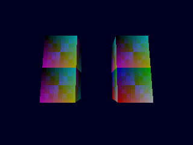

## Draft v0.3.0 (закрыт как draft; не опубликован; v0.2.1 withdrawn)

Публичного GitHub Release сейчас нет; v0.3.0 закрыт как draft 2026-11-15.
Те же артефакты можно собрать локально/в CI:

```sh
# SDK + UI package
cmake --preset pc-release && cmake --build --preset pc-release
cmake --build build/pc-release --target sdk_package
cmake --preset ui-release
cmake --build build/ui-release --target retro_engine_ui
python3 scripts/package_ui.py --build-dir build/ui-release --version 0.3.0

# Проверить gate и собрать payload (см. docs/RELEASING.md)
xvfb-run -a python3 scripts/verify_release_contract.py --w1-seconds 60 --skip-payload
python3 scripts/build_release_bundle.py \
  --sdk-archive dist/retro-engine-sdk-0.3.0-pc-linux-x86_64.tar.gz \
  --sdk-archive-n64 dist/retro-engine-sdk-0.3.0-n64-mips64.tar.gz \
  --ui-archive dist/retro-engine-ui-0.3.0-linux-x86_64.tar.gz \
  --report release_contract_report.json
python3 scripts/verify_release_contract.py --payload-only
```

Payload v0.3.0 (draft): `retro-engine-v0.3.0.tar.gz` (`sdk/` +
`sdk/platforms/n64/` + `ui/` + optional `demos/n64`) + отдельные
SDK/UI-архивы PC/PS1/Saturn/N64, checksums и отчёты gate.

Поддерживаемые hosts/targets v0.3.0 (draft):

| Host | PC | PS1 | Saturn | N64 |
|---|---|---|---|---|
| Linux x86_64 | CI | CI (PSn00bSDK v0.24) | CI (Jo Engine v2026.2) | CI (libdragon + GCC 16.2.0) |
| Windows x86_64 | CI | эксперим. (внешний PSn00bSDK) | эксперим. (внешний Jo Engine) | эксперим. (win64 toolchain + `n64tool.exe`) |
| macOS arm64 | CI | внешний toolchain, вне CI | внешний toolchain, вне CI | внешний toolchain, вне CI |

N64 reference/CI host — Linux x86_64; Windows-сборка экспериментальна,
macOS не проверяется. В payload нет Jaguar-артефактов, BIOS/ROM, ключей
и эмуляторов (gopher64 — env-install, не вендорится).

Remote CI v0.3.0 (PR #5, `2191d3a`): `build-n64`, `tests`, `sdk-package`,
`ui-client` и `build-pc/ps1/saturn` — success; release gate dry-run
`43720489809` — success, `publish` skipped; merge `2f7d9f4` — develop
green. Release notes:
[docs/RELEASE_NOTES_v0.3.0.md](docs/RELEASE_NOTES_v0.3.0.md). Полный гайд:
[docs/SDK.md](docs/SDK.md), [docs/UI_CLIENT.md](docs/UI_CLIENT.md).

## Сборка из исходников

```sh
git clone --recursive https://github.com/RetroPolyEngine/retro-engine.git
cd retro-engine

# PC debug + тесты
cmake --preset pc-debug
cmake --build --preset pc-debug
ctest --preset pc-debug --output-on-failure

# Release-пример
cmake --preset pc-release
cmake --build --preset pc-release
./build/pc-release/game/rotating_cube
```

> Без `--recursive` SDL3/googletest не подтянутся — см. [docs/BUILDING.md](docs/BUILDING.md).

## SDK (v0.3.0)

Движок собирается как устанавливаемый SDK с публичными заголовками,
CMake package, примерами и checksums (S33–34):

```sh
cmake --preset pc-release
cmake --build --preset pc-release
cmake --build build/pc-release --target sdk_package
```

```cmake
find_package(RetroPolyEngine CONFIG REQUIRED)
target_link_libraries(game PRIVATE RetroPolyEngine::retro_engine)
```

```cpp
#include <retro_engine/retro_engine.h>
```

Пакеты: `dist/retro-engine-sdk-<version>-{pc,ps1,saturn}-<arch>.{tar.gz,zip}`
и `retro-engine-sdk-<version>-n64-mips64.{tar.gz,zip}` (N64 SDK требует
внешний `N64_INST` + pinned libdragon; в manifest — цель
`RetroPolyEngine::n64_rsp_tnl`). Consumer smoke —
`scripts/sdk_consumer_smoke.py`; полное руководство —
[docs/SDK.md](docs/SDK.md), границы API — [ADR-011](docs/adr/ADR-011-public-sdk-api.md).

## UI client (v0.3.0)

Отдельный launcher/editor (SDL3 + Dear ImGui, MIT): создание/открытие
проекта, target PC/PS1/Saturn/N64, импорт ассетов через SDK
`asset_converter` (для N64 — `--platform n64`, 64×64 CI8+CLUT),
сборка CMake/Ninja и запуск target'а/эмулятора (N64 — gopher64).

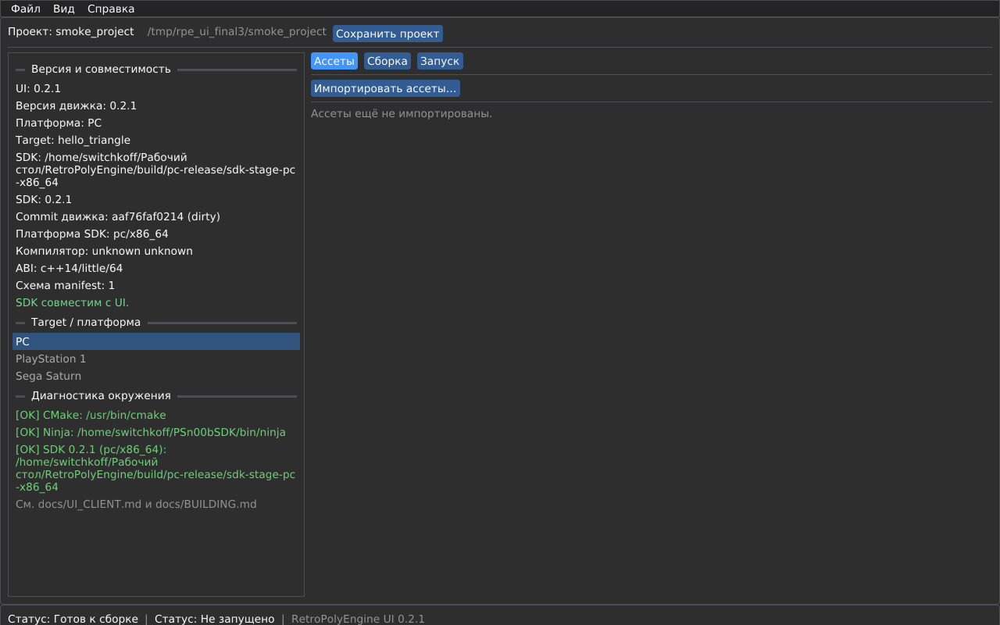

```sh
# сборка + unit-тесты ядра UI
cmake --preset ui-debug
cmake --build --preset ui-debug --target retro_engine_ui_tests
./build/ui-debug/tools/ui_client/retro_engine_ui_tests

# release-пакет
cmake --preset ui-release
cmake --build --preset ui-release --target retro_engine_ui
python3 scripts/package_ui.py --build-dir build/ui-release --version 0.3.0
```

Пакет: `dist/retro-engine-ui-<version>-<os>-<arch>.{tar.gz,zip}`;
руководство — [docs/UI_CLIENT.md](docs/UI_CLIENT.md), архитектура —
[ADR-012](docs/adr/ADR-012-ui-client.md), headless smoke —
`scripts/ui_smoke.py`, clean E2E — `scripts/ui_e2e.py`.

## Что внутри

- **Fixed-point ядро**: скаляр/вектор/матрицы Q16.16, saturating arithmetic,
  детерминированная тригонометрия — без float в игровой логике.
- **ECS**: 7 компонентных пулов с фиксированными ёмкостями, dense-итерация,
  generation-хэндлы с защитой от stale-use.
- **HAL**: единый C-API (`Platform/Render/Input/Audio/FileSystem`) с четырьмя
  compile-time бэкендами — PC (SDL3 + OpenGL 3.3), PS1 (PSn00bSDK,
  GTE+GPU+OT), Saturn HAL (Jo Engine, VDP1-полигоны/CLUT, VDP2 NBG1
  bitmap, Master+Slave SH-2, padded input) и N64 (libdragon, VI
  320×240, joypad, read-only DFS, memory ledger, render skeleton;
  RSP/RDP — S43–44).
- **Рендерер**: 320×240 reference framebuffer, affine-текстурирование,
  1/16-пиксельное квантование, Painter's algorithm, CI8/RGB555+STP.
- **Ассеты**: `.mesh` v1 (glTF→движок) и `.tex` v1 (PNG→CI8+палитра),
  host-only конвертер, безопасные загрузчики с rollback арены.
- **Демо MVP**: `rotating_cube` — 4 куба, 48 треугольников, AABB-коллизии,
  vertex lighting, debug overlay; W1 ≥ 60 FPS на PC, ≥ 30 FPS в DuckStation.

## Документация

| Документ | Назначение |
|---|---|
| [docs/RetroEngine_Engineering_Documentation_v1.43.md](docs/RetroEngine_Engineering_Documentation_v1.43.md) | Каноническая инженерная спецификация MVP (нормативная) |
| [docs/ARCHITECTURE.md](docs/ARCHITECTURE.md) | Слои движка, пайплайн рендера, ассет-пайплайн, платформенные контракты |
| [docs/BUILDING.md](docs/BUILDING.md) | Установка тулчейна, канонические пресеты, запуск PC/PS1/Saturn/N64, troubleshooting |
| [docs/SDK.md](docs/SDK.md) | SDK: install/export, `find_package`, примеры, пакеты PC/PS1/Saturn/N64, manifest/checksums |
| [docs/UI_CLIENT.md](docs/UI_CLIENT.md) | UI client: установка, project/target/import/build/run, диагностика, упаковка |
| [docs/SATURN.md](docs/SATURN.md) | Saturn: первоисточники, toolchain, разрешение, память, ввод, эмулятор |
| [docs/N64.md](docs/N64.md) | N64: reference-факты, toolchain/libdragon, ROM/CRC, memory ledger, DFS, input, RSP T&L/RDP/Z/TMEM, gopher64 gate |
| [docs/adr/ADR-008-saturn-backend.md](docs/adr/ADR-008-saturn-backend.md) | Нормативное решение по Saturn backend |
| [docs/adr/ADR-009-master-slave.md](docs/adr/ADR-009-master-slave.md) | Master+Slave SH-2: SPSC-синхронизация, workload, fallback |
| [docs/adr/ADR-011-public-sdk-api.md](docs/adr/ADR-011-public-sdk-api.md) | Границы публичного SDK API и install/export |
| [docs/adr/ADR-012-ui-client.md](docs/adr/ADR-012-ui-client.md) | UI client: SDL3 + Dear ImGui, `.rpeproject`, границы UI/SDK |
| [docs/adr/ADR-013-release-freeze.md](docs/adr/ADR-013-release-freeze.md) | Release freeze: любая публикация релизов отложена до v0.9.x, draft-only workflow |
| [docs/adr/ADR-014-n64-backend.md](docs/adr/ADR-014-n64-backend.md) | N64 backend: libdragon/toolchain, `.z64`, ROM header/CRC, gopher64 |
| [docs/adr/ADR-015-n64-rsp-rdp.md](docs/adr/ADR-015-n64-rsp-rdp.md) | N64 renderer: RSP T&L, RDP/Z, TMEM-текстуры, W0/W1 |
| [docs/API.md](docs/API.md) | Вводный обзор API: ECS, Renderer, Input, FileSystem, Math |
| [docs/ASSETS.md](docs/ASSETS.md) | Байтовые форматы `.mesh`/`.tex` v1, CLI конвертера, загрузчики |
| [docs/TESTING.md](docs/TESTING.md) | Пирамида тестов, запуск unit/integration/visual, QA-чек-листы |
| [docs/CONTRIBUTING.md](docs/CONTRIBUTING.md) | Форк→ветка→тесты→PR, стиль, Doxygen, review-процесс |
| [docs/OPENCODE_MCP.md](docs/OPENCODE_MCP.md) | Context7/TestSprite MCP в OpenCode: подключение и безопасное хранение API-ключей |
| [docs/CODE_OF_CONDUCT.md](docs/CODE_OF_CONDUCT.md) | Contributor Covenant |
| [docs/LEGAL.md](docs/LEGAL.md) | Лицензии зависимостей и правила сохранения notices |
| [docs/STYLE_GUIDE.md](docs/STYLE_GUIDE.md) | Именование, форматирование, ограничения языка |
| [docs/TROUBLESHOOTING.md](docs/TROUBLESHOOTING.md) | Частые проблемы и решения |
| [docs/DEVELOPMENT_PLAN.md](docs/DEVELOPMENT_PLAN.md) | Операционный план: вехи M0–M8, PERT, критический путь, гейты G1–G13 |
| [docs/plans/README.md](docs/plans/README.md) | Детальные планы спринтов (`docs/plans/sprint_NN.md`) |
| [docs/RELEASING.md](docs/RELEASING.md) | Релизная политика: обязательные SDK + UI client, gate v2, статус v0.2.0 |
| [docs/RELEASE_NOTES_v0.2.1.md](docs/RELEASE_NOTES_v0.2.1.md) | DRAFT release notes v0.2.1 (withdrawn; не опубликованы) |
| [docs/RELEASE_NOTES_v0.3.0.md](docs/RELEASE_NOTES_v0.3.0.md) | DRAFT release notes v0.3.0 (N64; draft/frozen) |

## Скриншоты

| hello_triangle PC | rotating_cube PC | hello_triangle PS1 (эмулятор) | hello_triangle Saturn v0.2.0 (Mednafen) |
|---|---|---|---|
| 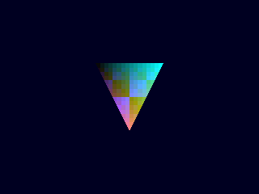 |  | 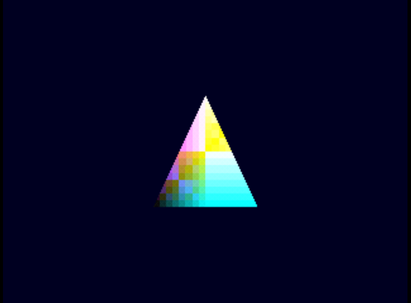 | 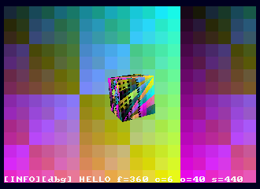 |

N64 boot-demo S39–40 (gopher64 1.2.1, 320×240 VI + RDPQ clear):

| hello_n64 boot |
|---|
| 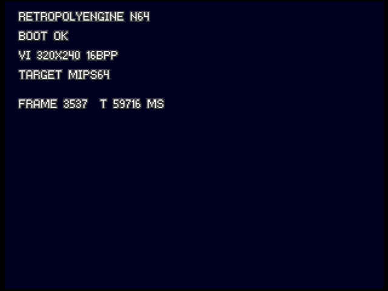 |

N64 HAL S41–42 (DFS `CUBE.MSH`/`TEX0.TEX`, memory overlay, input):

| n64 boot S41–42 |
|---|
| 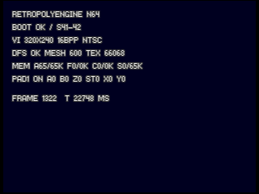 |

N64 renderer S43–44 (RSP T&L + lighting, RDP/Z, 4 текстурированных куба,
TMEM-полосы, bilinear; gopher64 1.2.1):

| n64 render S43–44 |
|---|
| 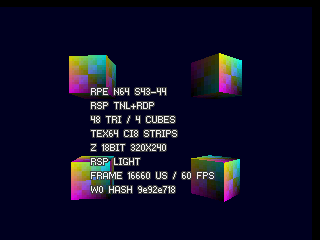 |

N64 S45–46 (v0.3.0 draft): hello_triangle и W1 rotating_cube,
overlay FPS/frame/RDRAM/TMEM/TNL/RDP; gopher64 1.2.1:

| n64 hello_triangle | n64 rotating_cube |
|---|---|
| 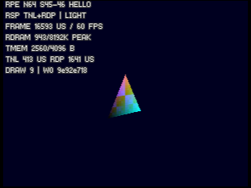 | 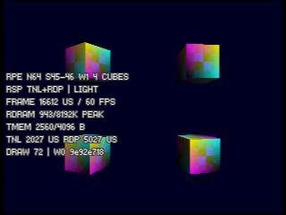 |

UI client:

| Welcome | Project | Assets | Build log | Run |
|---|---|---|---|---|
| 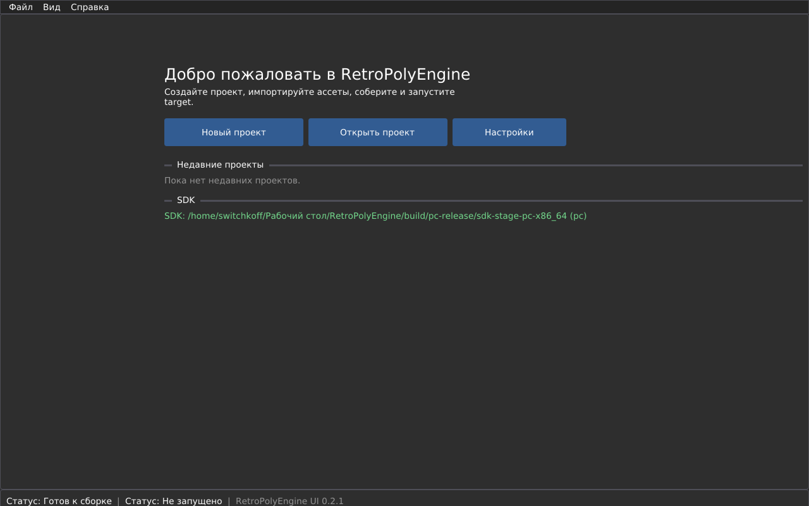 |  | 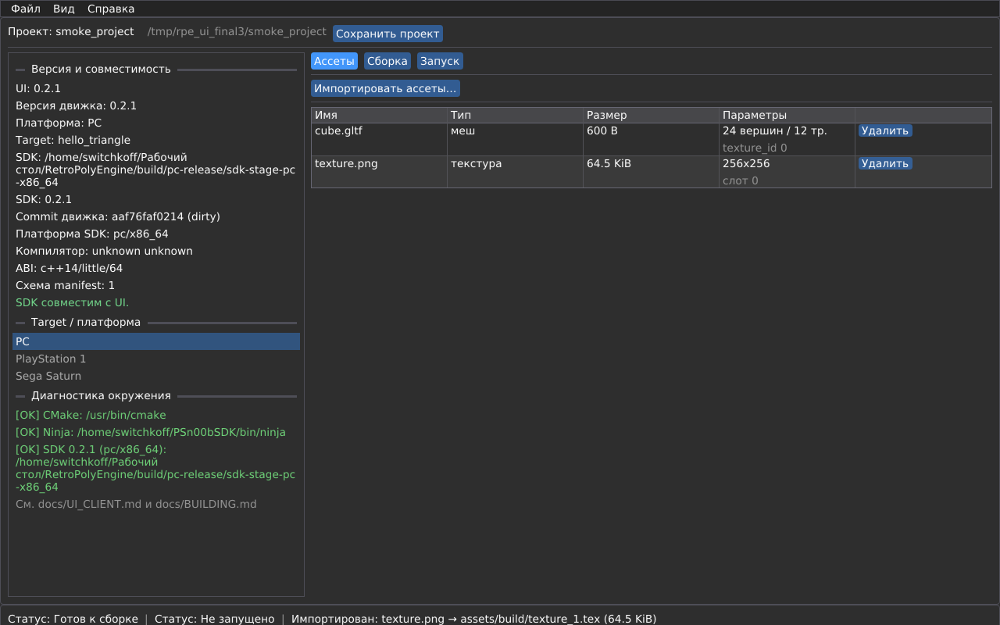 | 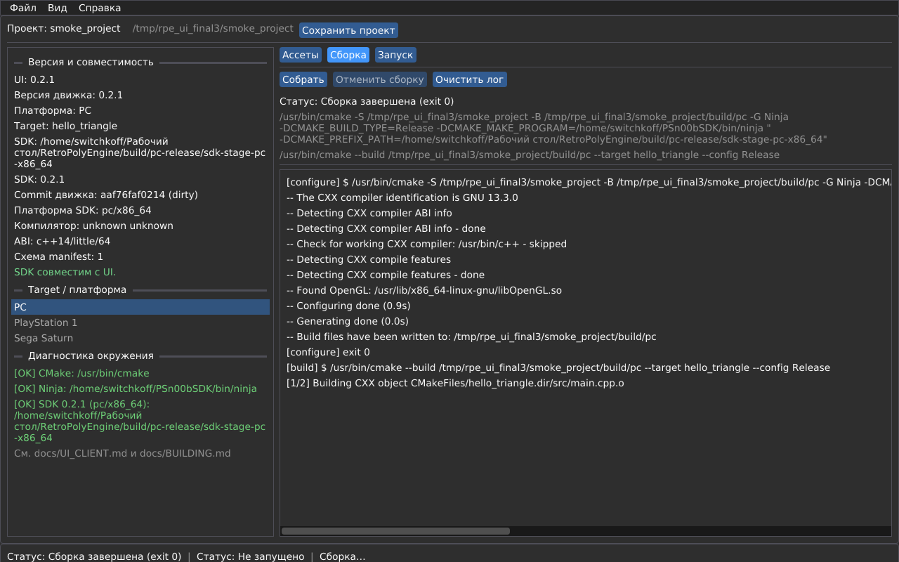 | 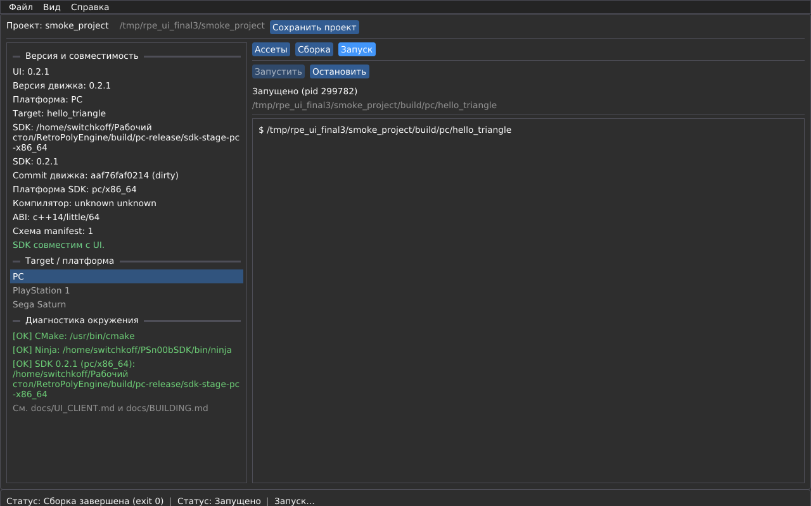 |

UI client gate: `.cue` из UI-проекта запущен в эмуляторах:

| PS1 (DuckStation) | Saturn (Mednafen 1.32.1) |
|---|---|
| 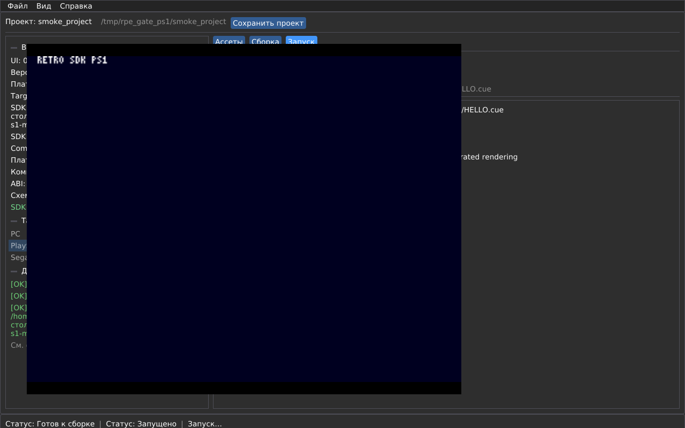 | 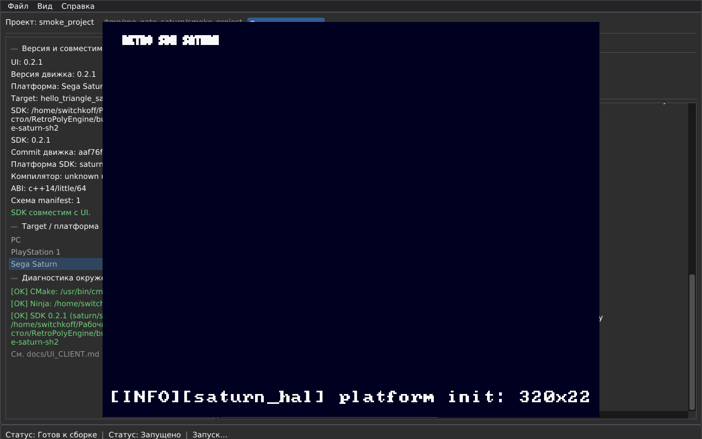 |

Saturn `hello_triangle`: D-pad — поворот объекта, A/B — дистанция камеры,
C/X — высота, Y/Z — орбита, Start — сброс. Сборка/запуск —
[docs/BUILDING.md](docs/BUILDING.md#сборка-saturn).

## Канонические пресеты

Единственная точка входа — `CMakePresets.json`:

| Пресет | Назначение |
|---|---|
| `pc-debug` | Разработка + unit-тесты |
| `pc-release` | Оптимизированные примеры |
| `pc-debug-render` | W0-golden + visual regression (`xvfb-run` в CI) |
| `ui-debug` | UI client Debug + core-тесты |
| `ui-release` | UI client Release (пакет) |
| `pc-asan` | AddressSanitizer |
| `pc-bench` | google/benchmark |
| `pc-coverage` | lcov покрытие |
| `ps1-release` | Кросс-сборка PS-EXE + CD-образ |
| `saturn-release` | Saturn hello_triangle: SH-2 ELF + bootable ISO/CUE |
| `n64-release` | N64 hello_triangle/rotating_cube: `.z64` + DFS (`mkdfs`) + map + sha256 (libdragon) |

Подробнее — [docs/BUILDING.md](docs/BUILDING.md).

## Статус MVP v0.1.0

- [x] Fixed-point математика (M1)
- [x] Аллокаторы + ECS (M1)
- [x] HAL PC + OpenGL-рендерер (M2)
- [x] Конвертер ассетов + безопасные загрузчики (M3)
- [x] hello_triangle PC (M4)
- [x] HAL PS1 + CD-ROM ФС (M5)
- [x] hello_triangle PS1 (M6)
- [x] rotating_cube demo (M7)
- [x] Документация + release gate (M8)
- [x] SDK packaging: install/export, CMake package, consumer smoke (S33–34)
- [x] UI client MVP: project/target/import/build/run, package, smoke/E2E (S35–36)
- [x] Release gate v2: payload `sdk/`+`ui/`, checksums, negative-tests (S37–38)
- [x] N64 S39–40: libdragon/toolchain, bootable `.z64`, CI, docs/N64.md, ADR-014
- [x] N64 S41–42: HAL VI/input/DFS/память, render skeleton, gopher64 gate
- [x] N64 S43–44: RSP T&L + RSP lighting, RDPQ/Z/TMEM, W0/W1, gopher64 gate
- [x] N64 S45–46: hello_triangle/rotating_cube, бюджеты, N64 SDK/UI, draft v0.3.0
- [ ] Jaguar S47–52: **DEFERRED — «до лучших времён»** + LEGAL HOLD — поддержка платформы отложена; связка зафиксирована в [ADR-016](docs/adr/ADR-016-jaguar-deferred.md); работы не начинаются, пока maintainer сам не разрешит старт
- [ ] 3DO: **исключён из roadmap** (2026-11-15); поддержка не добавляется, S53+ не планируются
- [ ] Публикация отложена до v0.9.x (release freeze); v0.2.1 Release удалён/отозван

Release-контракт: `scripts/verify_release_contract.py`. Политика публикации:
[docs/RELEASING.md](docs/RELEASING.md). Любая публикация релизов отложена до
**v0.9.x**; N64 **v0.3.0** (S39–46) собран как draft. Jaguar v0.4.0
(S47–52) — **DEFERRED — «до лучших времён»** + LEGAL HOLD; старт — только
по личному разрешению maintainer; связка: VJ external (GPL-3.0) + MIT-профиль
SDK (`m68k-elf-gcc`/binutils/`lyxass` + свой HAL) + собственный MIT `jagcd`;
ответы —
[jaguar_emulator_sdk_answers.md](docs/plans/jaguar_emulator_sdk_answers.md),
решение — [ADR-016](docs/adr/ADR-016-jaguar-deferred.md); планы сохранены
как draft/reference — [sprint_33_34](docs/plans/sprint_33_34.md),
[sprint_35_36](docs/plans/sprint_35_36.md),
[sprint_37_38](docs/plans/sprint_37_38.md),
[sprint_39_40](docs/plans/sprint_39_40.md),
[sprint_41_42](docs/plans/sprint_41_42.md),
[sprint_43_44](docs/plans/sprint_43_44.md),
[sprint_45_46](docs/plans/sprint_45_46.md),
[sprint_47_48](docs/plans/sprint_47_48.md),
[sprint_49_50](docs/plans/sprint_49_50.md),
[sprint_51_52](docs/plans/sprint_51_52.md).

## Лицензия

MIT — см. [LICENSE](LICENSE). Вендоренные зависимости и их лицензии:
[LEGAL.md](LEGAL.md).
