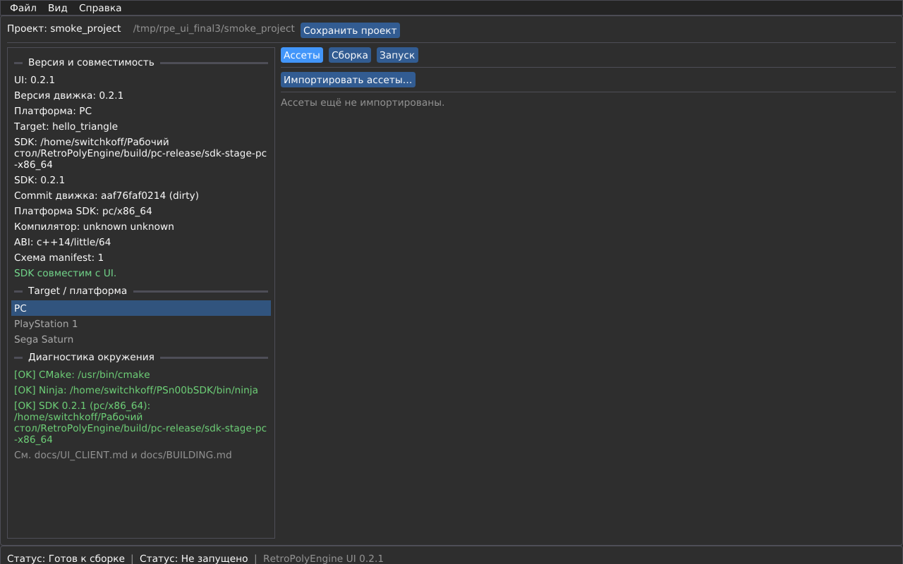
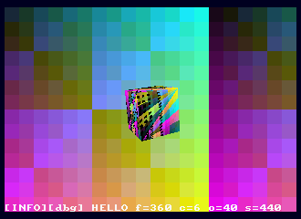
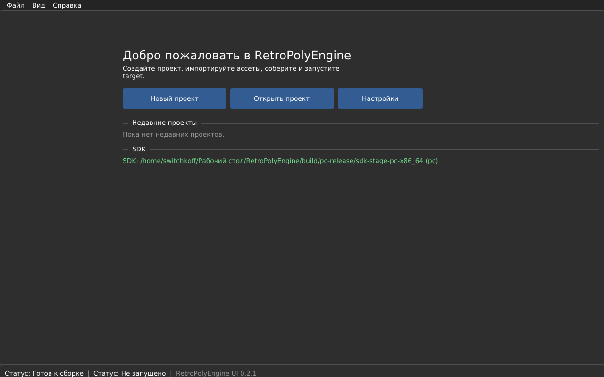
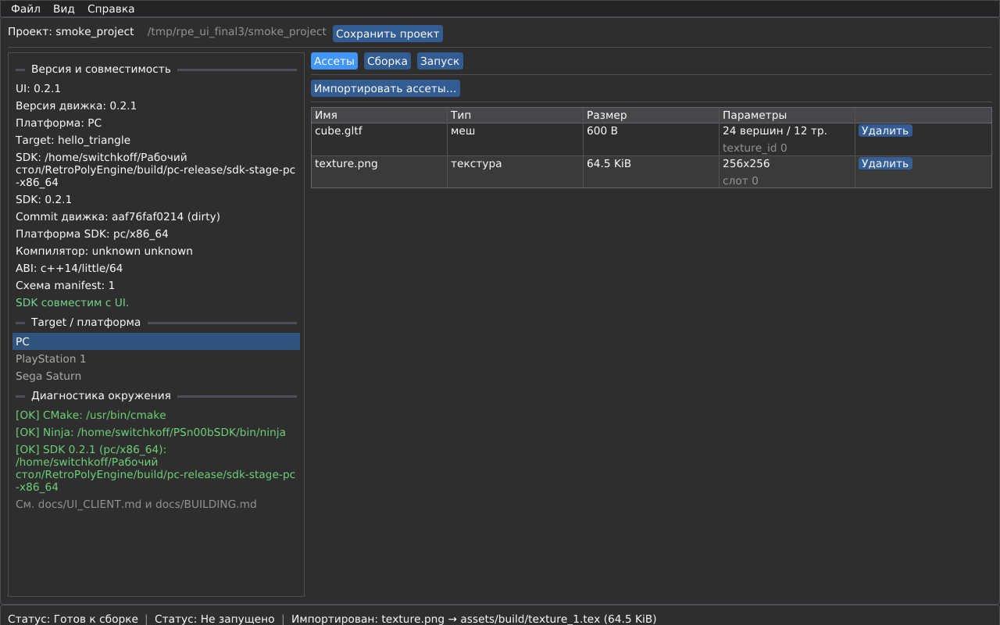
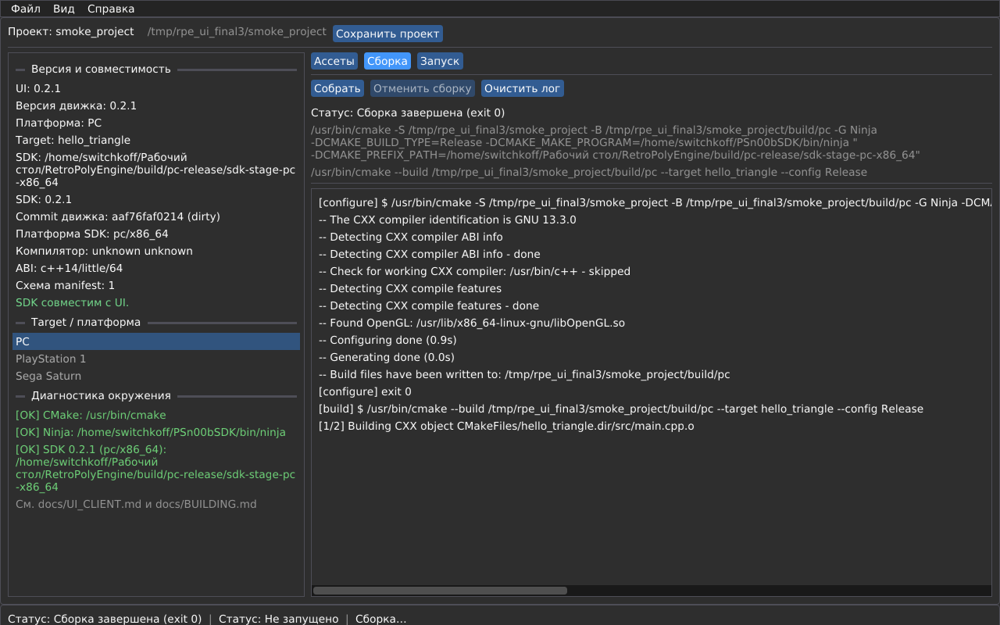
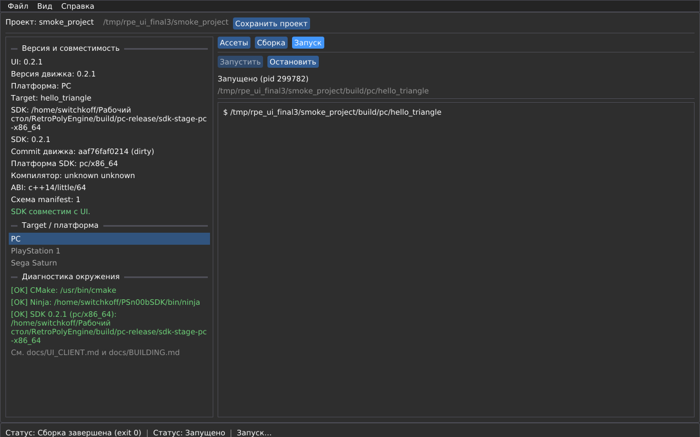

# RetroPolyEngine (retro-engine)

Кроссплатформенный детерминированный движок для ретро-платформ: ядро на
fixed-point математике (Q16.16, без плавающей запятой в игровой логике),
HAL-архитектура с нулевым runtime-аллокатором в горячих путях. Целевые
платформы MVP v0.1.0 — PC (SDL3 + OpenGL 3.3) и Sony PlayStation 1
(PSn00bSDK v0.24, pinned). v0.2.0 — Sega Saturn: pinned Jo Engine
v2026.2, bootable **hello_triangle** 320×224; Master + Slave SH-2
(SPSC-очередь, fallback), VDP1-полигоны/текстуры/CLUT/Gouraud (ADR-010) и
VDP2 NBG1 bitmap-фон с VBlank-scroll (S27–30); 6-button pad и 60 Гц
кадровый цикл (S31–32). **Публикация v0.2.0 отозвана:** payload содержал
demo-образы, но не готовый SDK и UI-клиент — см.
[docs/RELEASING.md](docs/RELEASING.md).


## Быстрый старт

```sh
git clone --recursive https://github.com/RetroPolyEngine/retro-engine.git
cd retro-engine

# PC debug + тесты
cmake --preset pc-debug
cmake --build --preset pc-debug
ctest --preset pc-debug --output-on-failure

# Запуск примера
./build/pc-release/game/rotating_cube
```

> Без `--recursive` SDL3/googletest не подтянутся — см. [docs/BUILDING.md](docs/BUILDING.md).

## SDK (v0.2.1)

Движок собирается как устанавливаемый SDK с публичными заголовками,
CMake package, примерами и checksums (S33–34):

```sh
cmake --preset pc-release
cmake --build --preset pc-release
cmake --build build/pc-release --target sdk_package
```

```cmake
find_package(RetroPolyEngine CONFIG REQUIRED)
target_link_libraries(game PRIVATE RetroPolyEngine::retro_engine)
```

```cpp
#include <retro_engine/retro_engine.h>
```

Пакеты: `dist/retro-engine-sdk-<version>-{pc,ps1,saturn}-<arch>.{tar.gz,zip}`;
consumer smoke — `scripts/sdk_consumer_smoke.py`; полное руководство —
[docs/SDK.md](docs/SDK.md), границы API — [ADR-011](docs/adr/ADR-011-public-sdk-api.md).

## UI client (v0.2.1)

Отдельный launcher/editor (SDL3 + Dear ImGui, MIT): создание/открытие
проекта, target PC/PS1/Saturn, импорт ассетов через SDK
`asset_converter`, сборка CMake/Ninja и запуск target'а/эмулятора.



```sh
# сборка + unit-тесты ядра UI
cmake --preset ui-debug
cmake --build --preset ui-debug --target retro_engine_ui_tests
./build/ui-debug/tools/ui_client/retro_engine_ui_tests

# release-пакет
cmake --preset ui-release
cmake --build --preset ui-release --target retro_engine_ui
python3 scripts/package_ui.py --build-dir build/ui-release --version 0.2.1
```

Пакет: `dist/retro-engine-ui-<version>-<os>-<arch>.{tar.gz,zip}`;
руководство — [docs/UI_CLIENT.md](docs/UI_CLIENT.md), архитектура —
[ADR-012](docs/adr/ADR-012-ui-client.md), headless smoke —
`scripts/ui_smoke.py`, clean E2E — `scripts/ui_e2e.py`.

## Что внутри

- **Fixed-point ядро**: скаляр/вектор/матрицы Q16.16, saturating arithmetic,
  детерминированная тригонометрия — без float в игровой логике.
- **ECS**: 7 компонентных пулов с фиксированными ёмкостями, dense-итерация,
  generation-хэндлы с защитой от stale-use.
- **HAL**: единый C-API (`Platform/Render/Input/Audio/FileSystem`) с тремя
  compile-time бэкендами — PC (SDL3 + OpenGL 3.3), PS1 (PSn00bSDK,
  GTE+GPU+OT) и Saturn HAL (Jo Engine, VDP1-полигоны/CLUT, VDP2 NBG1
  bitmap, Master+Slave SH-2, padded input).
- **Рендерер**: 320×240 reference framebuffer, affine-текстурирование,
  1/16-пиксельное квантование, Painter's algorithm, CI8/RGB555+STP.
- **Ассеты**: `.mesh` v1 (glTF→движок) и `.tex` v1 (PNG→CI8+палитра),
  host-only конвертер, безопасные загрузчики с rollback арены.
- **Демо MVP**: `rotating_cube` — 4 куба, 48 треугольников, AABB-коллизии,
  vertex lighting, debug overlay; W1 ≥ 60 FPS на PC, ≥ 30 FPS в DuckStation.

## Документация

| Документ | Назначение |
|---|---|
| [docs/RetroEngine_Engineering_Documentation_v1.43.md](docs/RetroEngine_Engineering_Documentation_v1.43.md) | Каноническая инженерная спецификация MVP (нормативная) |
| [docs/ARCHITECTURE.md](docs/ARCHITECTURE.md) | Слои движка, пайплайн рендера, ассет-пайплайн, платформенные контракты |
| [docs/BUILDING.md](docs/BUILDING.md) | Установка тулчейна, канонические пресеты, запуск PC/PS1/Saturn, troubleshooting |
| [docs/SDK.md](docs/SDK.md) | SDK: install/export, `find_package`, примеры, пакеты PC/PS1/Saturn, manifest/checksums |
| [docs/UI_CLIENT.md](docs/UI_CLIENT.md) | UI client: установка, project/target/import/build/run, диагностика, упаковка |
| [docs/SATURN.md](docs/SATURN.md) | Saturn: первоисточники, toolchain, разрешение, память, ввод, эмулятор |
| [docs/adr/ADR-008-saturn-backend.md](docs/adr/ADR-008-saturn-backend.md) | Нормативное решение по Saturn backend |
| [docs/adr/ADR-009-master-slave.md](docs/adr/ADR-009-master-slave.md) | Master+Slave SH-2: SPSC-синхронизация, workload, fallback |
| [docs/adr/ADR-011-public-sdk-api.md](docs/adr/ADR-011-public-sdk-api.md) | Границы публичного SDK API и install/export |
| [docs/adr/ADR-012-ui-client.md](docs/adr/ADR-012-ui-client.md) | UI client: SDL3 + Dear ImGui, `.rpeproject`, границы UI/SDK |
| [docs/API.md](docs/API.md) | Вводный обзор API: ECS, Renderer, Input, FileSystem, Math |
| [docs/ASSETS.md](docs/ASSETS.md) | Байтовые форматы `.mesh`/`.tex` v1, CLI конвертера, загрузчики |
| [docs/TESTING.md](docs/TESTING.md) | Пирамида тестов, запуск unit/integration/visual, QA-чек-листы |
| [docs/CONTRIBUTING.md](docs/CONTRIBUTING.md) | Форк→ветка→тесты→PR, стиль, Doxygen, review-процесс |
| [docs/OPENCODE_MCP.md](docs/OPENCODE_MCP.md) | Context7/TestSprite MCP в OpenCode: подключение и безопасное хранение API-ключей |
| [docs/CODE_OF_CONDUCT.md](docs/CODE_OF_CONDUCT.md) | Contributor Covenant |
| [docs/LEGAL.md](docs/LEGAL.md) | Лицензии зависимостей и правила сохранения notices |
| [docs/STYLE_GUIDE.md](docs/STYLE_GUIDE.md) | Именование, форматирование, ограничения языка |
| [docs/TROUBLESHOOTING.md](docs/TROUBLESHOOTING.md) | Частые проблемы и решения |
| [docs/DEVELOPMENT_PLAN.md](docs/DEVELOPMENT_PLAN.md) | Операционный план: вехи M0–M8, PERT, критический путь, гейты G1–G13 |
| [docs/plans/README.md](docs/plans/README.md) | Детальные планы спринтов (`docs/plans/sprint_NN.md`) |
| [docs/RELEASING.md](docs/RELEASING.md) | Релизная политика: обязательные SDK + UI client, gate v2, статус v0.2.0 |

## Скриншоты

| hello_triangle PC | rotating_cube PC | hello_triangle PS1 (эмулятор) | hello_triangle Saturn v0.2.0 (Mednafen) |
|---|---|---|---|
|  |  |  |  |

UI client:

| Welcome | Project | Assets | Build log | Run |
|---|---|---|---|---|
|  |  |  |  |  |

Saturn `hello_triangle`: D-pad — поворот объекта, A/B — дистанция камеры,
C/X — высота, Y/Z — орбита, Start — сброс. Сборка/запуск —
[docs/BUILDING.md](docs/BUILDING.md#сборка-saturn).

## Канонические пресеты

Единственная точка входа — `CMakePresets.json`:

| Пресет | Назначение |
|---|---|
| `pc-debug` | Разработка + unit-тесты |
| `pc-release` | Оптимизированные примеры |
| `pc-debug-render` | W0-golden + visual regression (`xvfb-run` в CI) |
| `ui-debug` | UI client Debug + core-тесты |
| `ui-release` | UI client Release (пакет) |
| `pc-asan` | AddressSanitizer |
| `pc-bench` | google/benchmark |
| `pc-coverage` | lcov покрытие |
| `ps1-release` | Кросс-сборка PS-EXE + CD-образ |
| `saturn-release` | Saturn hello_triangle: SH-2 ELF + bootable ISO/CUE |

Подробнее — [docs/BUILDING.md](docs/BUILDING.md).

## Статус MVP v0.1.0

- [x] Fixed-point математика (M1)
- [x] Аллокаторы + ECS (M1)
- [x] HAL PC + OpenGL-рендерер (M2)
- [x] Конвертер ассетов + безопасные загрузчики (M3)
- [x] hello_triangle PC (M4)
- [x] HAL PS1 + CD-ROM ФС (M5)
- [x] hello_triangle PS1 (M6)
- [x] rotating_cube demo (M7)
- [x] Документация + release gate (M8)
- [x] SDK packaging: install/export, CMake package, consumer smoke (S33–34)
- [x] UI client MVP: project/target/import/build/run, package, smoke/E2E (S35–36)
- [ ] Release gate v2 + публикация v0.2.1 (S37–38)

Release-контракт: `scripts/verify_release_contract.py`. Политика публикации:
[docs/RELEASING.md](docs/RELEASING.md). Следующий этап — **S33–38 /
v0.2.1**: SDK packaging + UI client; планы —
[docs/plans/sprint_33_34.md](docs/plans/sprint_33_34.md),
[sprint_35_36](docs/plans/sprint_35_36.md), [sprint_37_38](docs/plans/sprint_37_38.md).

## Лицензия

MIT — см. [LICENSE](LICENSE). Вендоренные зависимости и их лицензии:
[LEGAL.md](LEGAL.md).
