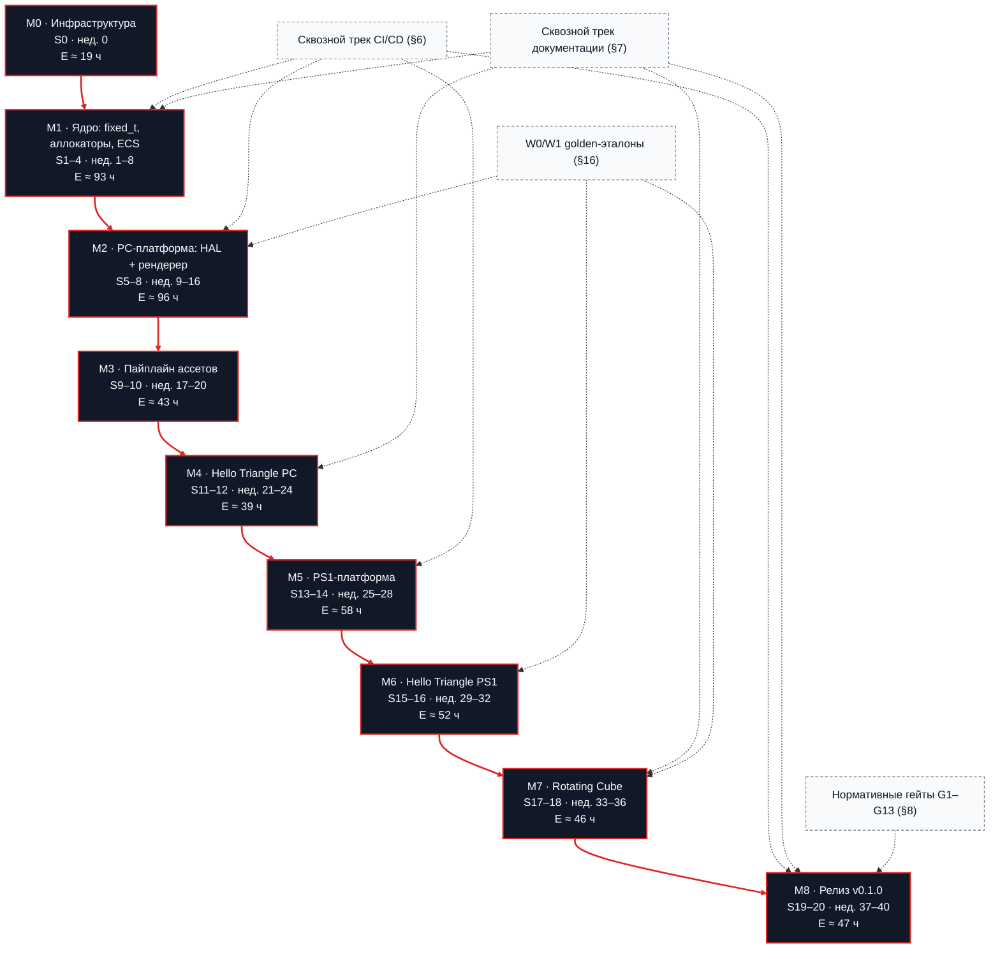
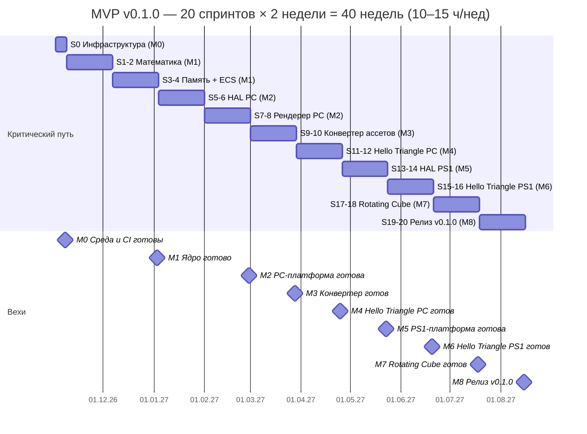

# RetroPolyEngine — Детальный план разработки (Development Plan)

> **Источник:** `RetroEngine_Engineering_Documentation_v1.43.md` (каноническая инженерная спецификация MVP, дата 2026-09-07).
> **Статус:** операционный план работ. Детальные чек-боксы спринтов разложены на атомарные действия в `plans/sprint_NN.md` (указатель — §2.5); этот файл содержит своды, вехи, PERT-оценки, сквозные треки и нормативные приложения.
> **Скоуп:** MVP v0.1.0 — PC (SDL3 + OpenGL 3.3) + Sony PlayStation 1 (PSn00bSDK v0.24, target `mipsel-none-elf`).
> **Сроки:** 20 спринтов × 2 недели = 40 недель (~10 месяцев) при 10–15 ч/нед. Recovery/buffer-недели учитываются отдельно и не входят в 40 недель. Ориентир календаря: старт Спринта 0 — 02.11.2026, релиз — 15.08.2027 (см. §2.3).

---

## 1. Как пользоваться планом

1. Работай чек-боксами: `- [ ]` → `- [x]`. Незавершённый пункт переносится в следующий спринт явно (не молча).
2. Ритм работы:
   - 1 спринт = 2 календарные недели = 20–30 рабочих часов.
   - В конце спринта: sprint review (30 мин) — сверить чек-боксы, зафиксировать недоделки, обновить CHANGELOG.
   - Каждые 2 спринта — «работающий результат» (демо/артефакт, который можно показать).
3. Scope reduction: если спринт затягивается — отсекать фичи, а не двигать границу MVP.
4. Ветвление git: `develop` — основная, `feature/*`, `fix/*`, `release/*`, `hotfix/*`. Merge в `develop` через squash-PR; релизы — merge в `main` + тег `v*`.
5. Все сборки — только через канонические пресеты: `pc-debug`, `pc-release`, `pc-debug-render`, `ps1-release` (+ опциональные `pc-asan`, `pc-bench`, `pc-coverage`). Никаких ручных `cmake -B` с нестандартными путями.
6. Изменение любого нормативного значения (бюджеты, форматы, пресеты) = обновление `ci/normative_contracts.yaml` + соответствующего ADR/теста **в одном изменении**.
7. Структура файлов: детальные чек-боксы спринтов живут в `plans/sprint_NN.md` (указатель — §2.5, сводка — `plans/README.md`); чек-боксы обновляются только там. Этот файл — вехи, критический путь, PERT-сводка, треки и нормативные приложения; при расхождении файл спринта первичен для задач, этот — для контрактов.

Легенда приоритетов внутри спринта: **[B]** blocking (без этого нельзя идти дальше), **[H]** high, **[M]** medium (можно перенести).

---

## 2. Карта вех, критический путь и PERT-оценки

### 2.1. Вехи

| Веха | Спринты | Недели | Результат (артефакт) |
|---|---|---|---|
| M0. Инфраструктура | 0 | — | Среда, репозиторий, CI на PC |
| M1. Ядро | 1–4 | 1–8 | fixed-point + Vec/Mat + аллокаторы + ECS + GTest в CI |
| M2. PC-платформа | 5–8 | 9–16 | HAL PC (окно/ввод/аудио/ФС) + OpenGL-рендерер с эмуляцией PS1 |
| M3. Пайплайн ассетов | 9–10 | 17–20 | `asset_converter` (glTF→.mesh, PNG→.tex), интеграция с CMake |
| M4. Hello Triangle PC | 11–12 | 21–24 | Первый пример: меш + текстура + камера, W1 ≥ 60 FPS |
| M5. PS1-платформа | 13–14 | 25–28 | HAL PS1, GTE, OT, загрузка PS-EXE в DuckStation |
| M6. Hello Triangle PS1 | 15–16 | 29–32 | Ассеты с CD-ROM, RAM ≤ 1.5 MiB, VRAM ≤ 800 KiB, W1 ≥ 30 FPS (эмулятор) |
| M7. Rotating Cube | 17–18 | 33–36 | Демо MVP: сцена кубов, AABB-коллизии, Gouraud, debug overlay |
| M8. Релиз v0.1.0 | 19–20 | 37–40 | Документация, release gate, GitHub Release, анонс |

**Критический путь:** математика → память/ECS → HAL PC → рендерер PC → конвертер → hello_triangle(PC) → HAL PS1 → hello_triangle(PS1) → rotating_cube → релиз.
**Зависимости-ловушки:**
- `rotating_cube` и `hello_triangle` ссылаются только на `retro_engine` (не на SDL3/OpenGL/PSn00bSDK напрямую).
- PS1-сборка потребляет **заранее сгенерированные** `assets/build/*.mesh/.tex` (конвертер — host-only, никогда не компилируется MIPS-тулчейном).
- W0-golden-хэш (framebuffer conformance) нужен до релиза — заложить в спринты 7–8 и 15–16.

### 2.2. Граф вех и зависимостей (Mermaid)

Все вехи лежат на едином критическом пути (красные рёбра). Сквозные треки (CI, документация, гейты, W0/W1-эталоны) показаны пунктиром: дат они не двигают, но их провал блокирует закрытие соответствующей вехи.



### 2.3. Календарный план (Mermaid Gantt)

Даты привязаны к понедельникам (старт Спринта 0 — 02.11.2026, релиз — 15.08.2027); recovery/buffer-недели в график не входят (см. заголовок плана).



### 2.4. PERT-оценки по спринтам

Методика (три-точечная оценка PERT; единица — рабочие часы):
- **O** — оптимистично (всё гладко, SDK/доки не подводят);
- **M** — наиболее вероятно (обычные затыки при 10–15 ч/нед);
- **P** — пессимистично (документация/тулчейн глючат, переделки);
- **E = (O + 4M + P) / 6** — ожидаемая трудоёмкость; **σ = (P − O) / 6** — стандартное отклонение; **E + 2σ** — 95%-сценарий;
- доступно на пару спринтов: **40–60 ч** (2 спринта × 2 нед × 10–15 ч/нед).

| Спринты | Недели | Веха | O | M | P | E | σ | E+2σ | Вывод |
|---|---|---|---|---|---|---|---|---|---|
| S0 | 0 | M0 | 12 | 18 | 30 | 19.0 | 3.0 | 25.0 | вне 40-нед. окна (неделя 0) |
| S1–2 | 1–4 | M1 | 30 | 45 | 70 | 46.7 | 6.7 | 60.0 | ок; у нижней границы при 10 ч/нед |
| S3–4 | 5–8 | M1 | 30 | 45 | 70 | 46.7 | 6.7 | 60.0 | ок |
| S5–6 | 9–12 | M2 | 28 | 42 | 65 | 43.5 | 6.2 | 55.8 | ок |
| S7–8 | 13–16 | M2 | 35 | 50 | 80 | 52.5 | 7.5 | 67.5 | ⚠ дефицит 12.5 ч при 10 ч/нед |
| S9–10 | 17–20 | M3 | 30 | 42 | 60 | 43.0 | 5.0 | 53.0 | ок |
| S11–12 | 21–24 | M4 | 25 | 38 | 55 | 38.7 | 5.0 | 48.7 | ок; самый лёгкий на пути |
| S13–14 | 25–28 | M5 | 40 | 55 | 85 | 57.5 | 7.5 | 72.5 | ⚠ максимальный риск пути (115% номинала) |
| S15–16 | 29–32 | M6 | 35 | 50 | 75 | 51.7 | 6.7 | 65.0 | ⚠ дефицит 11.7 ч при 10 ч/нед |
| S17–18 | 33–36 | M7 | 30 | 45 | 65 | 45.8 | 5.8 | 57.5 | ок |
| S19–20 | 37–40 | M8 | 30 | 45 | 70 | 46.7 | 6.7 | 60.0 | ок; P поглощает баг-фикс-буфер |
| **Σ (S1–20)** | 1–40 | M1–M8 | — | — | — | **≈ 473** | — | **≈ 600**¹ | доступно 400–600 ч |

¹ Σ(E+2σ) — консервативная верхняя оценка (простая сумма по спринтам, не свёртка дисперсий). S0 в сумму не входит.

**Анализ реализуемости:**
- При **12 ч/нед** доступно 480 ч ≥ E ≈ 473 ч — план сходится, но без запаса (~7 ч): бюджет пересчитывается после каждого sprint review.
- При **10 ч/нед** доступно 400 ч — дефицит ≈ 73 ч. Варианты: (а) поднять темп до ≥ 12 ч/нед; (б) отсечь ≈ 73 ч объёма (все [M]-задачи + часть [H] в S7–8/S13–14/S15–16 → пост-MVP); (в) добавить ≈ 5–7 recovery-недель сверх 40-недельного окна.
- 95%-сценарий (≈ 600 ч) съедает всё окно даже при 15 ч/нед — P-сценарии трёх самых тяжёлых пар (S7–8, S13–14, S15–16) требуют превентивного резерва: recovery-недели сразу после S8, S14, S16.

**Правила пересчёта (на каждом sprint review):**
1. Фиксировать фактическую трудоёмкость выполненных задач (ч) в карточке спринта (`plans/sprint_NN.md`).
2. Пересматривать M и P оставшихся задач; пересчитывать E остатка пути.
3. Если E остатка > доступного остатка окна → включать scope reduction (§1, п. 3), а не «догонять за счёт качества/тестов».
4. Отставание > E+σ по паре спринтов = триггер recovery-недели.

### 2.5. Файлы планов спринтов

Детальные чек-боксы живут в `plans/`; этот файл — своды, треки, гейты и нормативные приложения (см. [`plans/README.md`](plans/README.md)).

| Файл | Спринты | Недели | Веха | Содержание |
|---|---|---|---|---|
| [sprint_00.md](plans/sprint_00.md) | 0 | 0 | M0 | Среда, тулчейн PS1, репозиторий, CMake-каркас, вендоринг, первый CI |
| [sprint_01_02.md](plans/sprint_01_02.md) | 1–2 | 1–4 | M1 | Fixed-point математика (Q16.16) + тесты детерминизма |
| [sprint_03_04.md](plans/sprint_03_04.md) | 3–4 | 5–8 | M1 | Аллокаторы (Linear/Pool/Stack) + ECS Registry |
| [sprint_05_06.md](plans/sprint_05_06.md) | 5–6 | 9–12 | M2 | HAL PC: SDL3-платформа, ввод, аудио-заглушка, ФС |
| [sprint_07_08.md](plans/sprint_07_08.md) | 7–8 | 13–16 | M2 | Рендерер OpenGL 3.3 с эмуляцией PS1 + W0-golden |
| [sprint_09_10.md](plans/sprint_09_10.md) | 9–10 | 17–20 | M3 | asset_converter (.mesh v1 / .tex v1) + безопасные загрузчики |
| [sprint_11_12.md](plans/sprint_11_12.md) | 11–12 | 21–24 | M4 | hello_triangle: ассеты, камера, цикл 60 Гц, W1-замер |
| [sprint_13_14.md](plans/sprint_13_14.md) | 13–14 | 25–28 | M5 | HAL PS1: GTE, OT, VRAM/DMA, pad, CD-ROM, CI |
| [sprint_15_16.md](plans/sprint_15_16.md) | 15–16 | 29–32 | M6 | hello_triangle на PS1: CD-ассеты, бюджеты RAM/VRAM/EXE |
| [sprint_17_18.md](plans/sprint_17_18.md) | 17–18 | 33–36 | M7 | rotating_cube: W1-сцена, коллизии, Gouraud, overlay |
| [sprint_19_20.md](plans/sprint_19_20.md) | 19–20 | 37–40 | M8 | Документация, release gate, GitHub Release, анонс |

---

## 3. Этап 0 — Подготовка среды и инфраструктуры (Спринт 0, неделя 0)

> **Детальный чек-лист: [`plans/sprint_00.md`](plans/sprint_00.md).** Ниже — сводка; работать по файлу спринта.
> **PERT:** O 12 / M 18 / P 30 → **E ≈ 19 ч**, σ 3.0 (95% ≈ 25 ч). Неделя 0 — вне 40-недельного окна MVP.

| Блок | Содержание |
|---|---|
| 3.1 | Базовые инструменты Windows 11: Git, CMake 3.25+, Ninja, VS2022 Build Tools, MSYS2, Cursor, DuckStation/PCSX-Redux |
| 3.2 | PS1-тулчейн: PSn00bSDK v0.24 (pin `06e65be`), переменные среды, смок-тест |
| 3.3 | glad (OpenGL 3.3 Core) → `src/third_party/glad/` |
| 3.4 | Репозиторий `retro-engine`: каркас каталогов по §10 ЭТАПА 4, ветка `develop` |
| 3.5 | Сборка: корневой CMakeLists, `CMakePresets.json` (4 канонических пресета), guard «ровно один PLATFORM_*» |
| 3.6 | Вендоринг: SDL3, PSn00bSDK (pin), GoogleTest, cgltf, stb; SHA-256 в `VERSION.txt` |
| 3.7 | Первый CI: `tests.yml` (ubuntu) зелёный на пустом каркасе |

- [ ] Гейт выхода из Этапа 0: `cmake --preset pc-debug` собирается, `ctest --preset pc-debug` зелёный, CI зелёный на пустом каркасе, `ps1-release` конфигурируется с pinned SDK

---

## 4. Итерация 1 — Ядро и PC (Спринты 1–12, недели 1–24)

> Детальные чек-листы — в файлах `plans/` (указатель в §2.5). Порядок строго последовательный: это критический путь.

| Файл | Спринты | Недели | Цель | Ключевой гейт выхода | PERT E |
|---|---|---|---|---|---|
| [sprint_01_02.md](plans/sprint_01_02.md) | 1–2 | 1–4 | Fixed-point математика | `fixed.h` Q16.16 saturating + Vec/Mat + детерминизм-тесты в CI | 46.7 ч |
| [sprint_03_04.md](plans/sprint_03_04.md) | 3–4 | 5–8 | Память + ECS | Linear/Pool/Stack + Registry (10 000 сущностей, retirement), ASan 0 findings | 46.7 ч |
| [sprint_05_06.md](plans/sprint_05_06.md) | 5–6 | 9–12 | HAL PC | Окно 1280×960 + GL 3.3 + SDL_Gamepad ввод + ФС + CI на 3 ОС | 43.5 ч |
| [sprint_07_08.md](plans/sprint_07_08.md) | 7–8 | 13–16 | Рендерер с эмуляцией PS1 | 320×240, affine+quantize, CI8/RGB555+STP, Painter's+command buffer, W0-golden хэш | 52.5 ч |
| [sprint_09_10.md](plans/sprint_09_10.md) | 9–10 | 17–20 | Конвертер ассетов | glTF→.mesh v1, PNG→.tex v1, CMake-интеграция, 7-шаговая валидация загрузчиков | 43.0 ч |
| [sprint_11_12.md](plans/sprint_11_12.md) | 11–12 | 21–24 | Hello Triangle PC | Меш+текстура+камера WASD, цикл 60 Гц, W1-equivalent ≥ 60 FPS | 38.7 ч |

Общий DoD каждого спринта — §17. Треки CI и документации для этих спринтов — §6 и §7.

---

## 5. Итерация 2 — PS1 и релиз (Спринты 13–20, недели 25–40)

> Детальные чек-листы — в файлах `plans/` (указатель в §2.5).

| Файл | Спринты | Недели | Цель | Ключевой гейт выхода | PERT E |
|---|---|---|---|---|---|
| [sprint_13_14.md](plans/sprint_13_14.md) | 13–14 | 25–28 | HAL PS1 | PS-EXE в DuckStation, GTE+OT-треугольник, VRAM/DMA, CD-ROM ФС, CI кросс-сборка | 57.5 ч |
| [sprint_15_16.md](plans/sprint_15_16.md) | 15–16 | 29–32 | Hello Triangle PS1 | Ассеты с ISO9660, W1 ≥ 30 FPS (эмулятор, speed 100%), RAM ≤ 1.5 MiB, VRAM ≤ 800 KiB, EXE ≤ 500 KiB | 51.7 ч |
| [sprint_17_18.md](plans/sprint_17_18.md) | 17–18 | 33–36 | Rotating Cube (демо MVP) | W1-сцена (4 куба / 48 тр-ков), AABB+гравитация, Gouraud, overlay, стресс 10 мин чистый | 45.8 ч |
| [sprint_19_20.md](plans/sprint_19_20.md) | 19–20 | 37–40 | Релиз v0.1.0 | `verify_release_contract.py` (9 assert-ов) зелёный, GitHub Release, анонс | 46.7 ч |

Общий DoD каждого спринта — §17; релизный чек-лист — §11.

---

## 6. Сквозной трек CI/CD (по спринтам)

| Workflow | Когда создать | Что делает |
|---|---|---|
| `tests.yml` | Спринт 0 | pc-debug: configure+build+ctest (ubuntu) |
| `build-pc.yml` | Спринт 5–6 | Матрица ubuntu/windows/macos, pc-release, ctest |
| `regression.yml` | Спринт 7–8 | pc-debug unit + `pc-debug-render` под `xvfb-run` (renderer integration) |
| `build-ps1.yml` | Спринт 13–14 | Pinned PSn00bSDK v0.24 + sha256; ps1-release; upload artifacts |
| `coverage.yml` | Спринт 15–16 | pc-coverage → lcov → Codecov (порог core/ > 70%) |
| `release.yml` | Спринт 19–20 | Тег v*: PC+PS1 артефакты + валидация + GitHub Release |
| `docs.yml` | Спринт 19–20 | Doxygen → GitHub Pages (по тегу) |
| `issue-triage.yml` | Спринт 19–20 | Автолейбл «needs-info» без шаблона |
| `stale.yml` | После релиза | 30 дней stale → 7 дней close |

**CI должен падать, когда:**
- [ ] больше одного PLATFORM_* cache-варианта true; или ни одного;
- [ ] используется не-канонический build-каталог;
- [ ] отсутствует PS1 toolchain file;
- [ ] сгенерированные .mesh/.tex не проходят format validation;
- [ ] отсутствуют PS1 EXE/image outputs;
- [ ] изменено нормативное значение без обновления `ci/normative_contracts.yaml` и ADR/теста в том же изменении.

---

## 7. Сквозной трек документации (минимум, по спринтам)

- Спринт 1–2: STYLE_GUIDE.md
- Спринт 9–10: ASSETS.md
- Спринт 11–12: README examples (hello_triangle)
- Спринт 17–18: README rotating_cube
- Спринт 19–20: README, ARCHITECTURE, BUILDING, API, LEGAL, CONTRIBUTING, CODE_OF_CONDUCT, TESTING, TROUBLESHOOTING, CHANGELOG v0.1.0, Doxyfile + GitHub Pages
- Пост-релиз (первые 1–3 мес): туториалы `docs/tutorials/01..10` (getting started, hello triangle, blender export, textures, building for PS1, ECS basics, custom components, custom systems, optimization, debugging)

---

## 8. Нормативные контракты — исполняемые гейты (чек-лист реализации)

Каждый инвариант из спецификации должен иметь машинно проверяемый тест/валидатор/CI-гейт. Реализация — по мере соответствующих спринтов; **перед релизом все должны быть зелёными.**

- [ ] **G1. Манифест:** `ci/normative_contracts.yaml` существует; CI сверяет его с конфигурацией (спринт 19–20)
- [ ] **G2. Fixed-point:** saturating add/sub/mul/div; Q16.16-масштаб mul; одна финальная редукция; div-by-zero контракт (спринт 1–2)
- [ ] **G3. Entity-хэндл:** stale-reject; generation++ на destroy; retirement при wrap 255 (спринт 3–4)
- [ ] **G4. RGB555+STP:** bit-layout тесты 0x801F/0x83E0/0xFC00; запрет псевдо-палитр (спринт 7–8 / 9–10)
- [ ] **G5. OT-глубина:** reject/clamp вне диапазона, без modulo; детерминированный unit-тест с golden-векторами (спринт 7–8, 13–14)
- [ ] **G6. Ассеты:** 7-шаговый порядок валидации; полный набор malformed-кейсов; арена не расходуется при фейле (спринт 9–10)
- [ ] **G7. CMake/CI-гейты:** ровно один backend; канонические пресеты; PS1 toolchain обязательен; артефакты PS1 обязательны (спринт 13–14 → 19–20)
- [ ] **G8. Renderer safety:** command-buffer/OT/arena overflow = status false + диагностика; silent drop запрещён (спринт 7–8, 13–14)
- [ ] **G9. Lifecycle:** Platform_Init → ровно один Render_Init; violation-тест (спринт 7–8)
- [ ] **G10. W0-конформанс:** 5 обязательных кейсов (visible/backface-culled/near-cross/far-cross/invalid-depth) детерминированы; golden-hash (спринт 7–8, повторно PS1 15–16)
- [ ] **G11. Release gate:** `verify_release_contract.py` со всеми assert-ами; результат — CI-artifact (спринт 19–20)
- [ ] **G12. W0/W1-отчётность:** любые FPS/память-заявления сопровождаются `benchmarks/reference_environment.yaml` (метаданные обязательны)
- [ ] **G13. Код-статус правил:** все код-блоки в репо/доках маркируются [NORMATIVE]/[REFERENCE]/[ILLUSTRATIVE]/[HISTORICAL]; [HISTORICAL] не попадают в canonical-секции

---

## 9. Бюджеты и лимиты — контрольный чек-лист (PS1)

- [ ] Peak main RAM ≤ 1 572 864 байт (1.5 MiB), включая runtime/SDK, stack, static data, все арены
  - [ ] Runtime/SDK reserve ≤ 128 KiB
  - [ ] CPU stack ≤ 64 KiB (мегабайтные буферы НЕ на стеке)
  - [ ] Static code/data ≤ 256 KiB
  - [ ] ECS/dynamic pools ≤ 256 KiB (жёсткий бюджет; см. компонентные ёмкости ниже)
  - [ ] Level linear arena ≤ 448 KiB
  - [ ] Per-frame arena ≤ 160 KiB
  - [ ] CD staging/cache = 64 KiB
  - [ ] Измерительный headroom ≤ 160 KiB (сумма явных арен = 1376 KiB)
  - [ ] Физический резерв 512 KiB — никогда не аллоцируется engine-системами
  - [ ] Exhaustion арены → явный OOM-диагностик, арена НЕ расширяется
- [ ] ECS-леджер: sparse-индекс 10 000 × u16 (20 KiB/pool) + dense-данные; ёмкости: Position 1024, Rotation 1024, Velocity 1024, MeshRenderer 256, Camera 8, PlayerControl 8, Collider 256; полное ECS-резервирование < 256 KiB с фиксированным запасом; любое увеличение ёмкостей = обновление леджера до реализации
- [ ] VRAM ≤ 819 200 байт (800 KiB): framebuffer + CLUT/палитры + texture pages + GPU drawing buffers; методика замера задокументирована бэкендом
- [ ] PS-EXE ≤ 500 KiB (512 000 байт); размер CD-образа — отдельная метрика релиза
- [ ] PC: RAM < 500 МБ; размер бинарника — build-метрика
- [ ] Время кадра: < 33 мс (PS1), < 16 мс (PC)
- [ ] FPS-гейты: PC W1 ≥ 60; PS1 W1 ≥ 30 (pinned DuckStation, speed 100%, ≥ 98% устойчивость, 60 c измерение)

---

## 10. План тестирования и QA (по слоям пирамиды)

### 10.1. Unit-тесты (70% усилий; порог покрытия core/ > 70%, алерт < 50%)
- [ ] Math: fixed (конверсии, арифметика, сатурация, div0, sqrt, stress 10k, детерминизм), Vec2/3/4, Mat3/4 (см. спринты 1–2)
- [ ] Memory: Linear (basic/align/OOM/reset/rollback/unaligned), Pool (foreign/interior/double-free/iteration), Stack (push-pop/foreign marker/reset) (спринт 3–4)
- [ ] ECS: lifecycle/components/view/stale/generation/perf (спринт 3–4)
- [ ] Texture: RGB555+STP bit layout (спринт 7–8)
- [ ] Render depth: OT reject без modulo (спринт 7–8)
- [ ] Logger: init/log/shutdown, файл создан, формат

### 10.2. Integration-тесты (25%)
- [ ] Renderer (pc-debug-render + xvfb): CreateTexture/DrawTriangle + framebuffer-hash сравнение с эталоном
- [ ] Mesh/Tex loaders: валидный файл, несуществующий, битый magic, полный malformed-набор, rollback арены
- [ ] HAL: Init/Shutdown, GetTimeMs, InputKeyboard smoke
- [ ] Asset round-trip: glTF→.mesh→load→render (гейт релиза)

### 10.3. E2E / Smoke (5%)
- [ ] PC: `timeout 10` запуск hello_triangle/rotating_cube без краша
- [ ] PS1 (DuckStation): manual/non-gating для MVP; норм. CI-гейт = кросс-компиляция + валидация артефактов; emulator QA — вручную или в отдельно pinned workflow
- [ ] Ручные чек-листы DuckStation: куб виден/вращается/камера/FPS/артефакты/5 мин без краша; скриншоты (F8) vs PC

### 10.4. Отладка PS1 (PCSX-Redux GDB)
- [ ] Настроить `target remote localhost:3333`, breakpoint main, watch переменных
- [ ] Использовать для багов, не ловящихся в DuckStation

### 10.5. Stress-тесты (после MVP-порога; manual/non-gating для v0.1.0)
- [ ] Память: PS1 — наблюдение MemoryProfiler (пик RAM/VRAM); PC — `pc-asan` прогон (leak-check)
- [ ] FPS: 1 час в pinned эмуляторе, лог FPS из debug overlay приложения (не из недокументированных CLI эмулятора); порог min ≥ 25
- [ ] Краши: 100 циклов load/unload уровня; 10k create/destroy entities; интенсивный ввод; 1 час без перезапуска — всё через **приложенческий тест-режим**, не через CLI эмулятора

### 10.6. Regression
- [ ] CI: regression.yml (unit + renderer integration)
- [ ] Визуальный: `scripts/visual_regression.sh` (ImageMagick `compare -metric AE`, порог DIFF записан вместе с reference-сетами)

### 10.7. Performance
- [ ] Бенчмарки: `pc-bench` (google/benchmark: fixed_mul, vec3_normalize, mat4_multiply, allocator latency baseline)
- [ ] PS1: benchmark-функция в приложении (итерации × время через Platform_GetTimeMs + Logger)
- [ ] Все публикации метрик — с environment-метаданными (G12)

### 10.8. Инструменты
- [ ] GTest (vendored), AddressSanitizer (`pc-asan`), Valgrind (Linux, опц.), lcov+Codecov, clang-tidy/cppcheck (0 ошибок), clang-format, Doxygen

---

## 11. Релиз v0.1.0 — финальный чек-лист (гейт)

Каждый пункт обязателен:
- [ ] 1. PC Release сборки зелёные на Windows/Linux/macOS CI
- [ ] 2. PS1 Release сборка зелёная с pinned PSn00bSDK v0.24 (+sha256)
- [ ] 3. Unit-тесты зелёные; sanitizer-прогоны без findings (поддерживаемые host-конфигурации)
- [ ] 4. hello_triangle и rotating_cube проходят сценарии PC и DuckStation; PS1 ФС-акцептанс через bootable .cue/.bin
- [ ] 5. Reference PS1-ворклоуд: peak main RAM ≤ 1.5 MiB; VRAM ≤ 800 KiB
- [ ] 6. PS-EXE ≤ 500 KiB; release-пакет содержит PC + PS1 артефакты
- [ ] 7. Malformed-ассеты безопасно отвергаются (offsets, truncated CI8)
- [ ] 8. Renderer-корректность подтверждена детерминированными framebuffer/reference-сравнениями (не только «не крашится»)
- [ ] 9. Нет открытых blocker/critical против release-коммита
- [ ] `verify_release_contract.py` выполнен и опубликован как artifact
- [ ] CHANGELOG [0.1.0] заполнен; тег; GitHub Release с бинарниками; анонсы

---

## 12. Пост-релизная поддержка (первые 3 месяца)

**Недели 1–2:**
- [ ] Ответить на все issues (SLA 48 ч)
- [ ] Исправить критические баги
- [ ] Обновить документацию по фидбеку
- [ ] Активное продвижение (Reddit/Twitter/Discord)

**Недели 3–4:**
- [ ] Патч v0.1.1 (если есть баг-фиксы): ветка `fix/*` от develop или `hotfix/*` от main → тег patch → release.yml
- [ ] 2–3 дополнительных туториала
- [ ] Первый Showcase в Discord

**Месяц 2:**
- [ ] Старт v0.2.0 (Saturn): изучение SH-2/VDP, toolchain-исследование
- [ ] 5–10 «good first issue»
- [ ] Первый Game Jam (план: раз в 6 мес)
- [ ] Обновить roadmap

**Месяц 3:**
- [ ] Релиз v0.2.0 (если готов)
- [ ] Интервью с контрибьюторами
- [ ] Анализ метрик: 100+ stars, 50+ Discord, 10+ issues, 5+ PR, 3+ игры

**Инфраструктура поддержки:**
- [ ] Шаблоны issue (bug_report/feature_request), лейблы (bug, enhancement, documentation, question, good first issue, help wanted, priority:*, platform:*, status:*)
- [ ] Классификация багов: Blocker (24 ч) / Critical (1 нед) / Major (2 нед) / Minor (1 мес) / Trivial
- [ ] Workflow обновления toolchain: ветка `update/psn00bsdk-vX.Y` → обновить pin+sha → собрать все пресеты + ctest → обновить LEGAL/BUILDING/CHANGELOG/ADR → PR (старый pin сохранён как rollback)
- [ ] Бэкап: `scripts/backup.bat` еженедельно (tar без build/, хранить 5); mirror на GitLab (опционально)

---

## 13. Post-MVP roadmap (после v0.1.0 — справочно)

- **v0.2.0 — Sega Saturn (8–12 спринтов):** изучение Master/Slave SH-2, VDP1 (квады) + VDP2 (фоны), синхронизация, Jo Engine/toolchain; hello_triangle на эмуляторе Saturn.
- **v0.3.0 — N64 (6–8 спринтов):** микрокод RCP (RSP+RDP), аппаратный Z-буфер, perspective-correct текстурирование, libdragon.
- **v0.4.0 — Jaguar (4–6 спринтов):** blitter-программирование (Tom), Jerry-DSP; 68000 host.
- **v0.5.0 — 3DO (4–6 спринтов):** CEL/MADAM-композитинг; отдельная юридическая проверка SDK перед любым vendoring/перераспределением.
- **v0.6.0–v0.8.0 — Аудио и ФС:** XA/PCM/ADPCM (SPU/SCSP/AI), расширенный ISO9660/CDFS, memory card save.
- Перед любой Tier-2/3 реализацией: повторная сверка hardware-спецификаций против первоисточников (данные будущих платформ — reference material).

---

## 14. Реестр рисков (операционный)

| Риск | Вероятн. | Влияние | Митигация |
|---|---|---|---|
| Выгорание | Высокая | Критич. | 10–15 ч/нед; recovery-недели отдельно; демо каждый спринт; поддержка сообщества |
| Нехватка времени | Высокая | Высокое | Строгое следование спринтам; scope reduction; AI-ассистенты на рутину; backup-план: v0.0.9 |
| PSn00bSDK/GTE сложности | Средняя | Высокое | Документация+примеры; Discord homebrew; сравнение с PC fixed-point; fallback PCSX-Redux HLE |
| Эмуляторы врут в таймингах | Средняя | Среднее | DuckStation primary; PCSX-Redux второй; реальная PS1 (~$20–107) после MVP для финальной валидации |
| Критические баги перед релизом | Средняя | Высокое | Неделя 39 = баг-фикс; ASan; 10-мин стресс; rollback на предыдущий коммит |
| Нет контрибьюторов | Средняя | Среднее | Продвижение; good first issue; быстрые ответы; jams/showcase |
| SDL3/SDK ломают API | Низкая | Среднее | Pin версий/submodules; adapter layer внутри PS1-адаптера; проверка минимальной версии SDK |
| Производительность PS1 ниже плана | Средняя | Среднее | GTE для трансформаций; меньше overdraw; DMA; fallback — упростить сцену |
| Отсутствие реального железа | — | — | Признать в релизных материалах: emulator validation gate ≠ hardware performance claim |

---

## 15. Приложение А — Шпаргалка команд

```bash
# PC
cmake --preset pc-debug && cmake --build --preset pc-debug
ctest --preset pc-debug --output-on-failure
cmake --preset pc-release && cmake --build --preset pc-release
ctest --preset pc-release --output-on-failure
cmake --preset pc-debug-render && cmake --build --preset pc-debug-render   # рендер-тесты (нужен GL контекст)
xvfb-run -a ctest --preset pc-debug-render --output-on-failure -R integration
cmake --preset pc-asan && cmake --build --preset pc-asan && ctest --preset pc-asan --output-on-failure
cmake --preset pc-bench && cmake --build --preset pc-bench                 # бенчмарки
cmake --preset pc-coverage && cmake --build --preset pc-coverage && ctest --preset pc-coverage

# PS1 (Windows)
set PSN00BSDK_ROOT=C:\PSn00bSDK
set PSN00BSDK_LIBS=%PSN00BSDK_ROOT%\lib\libpsn00b
set PATH=%PSN00BSDK_ROOT%\bin;%PATH%
cmake --preset ps1-release && cmake --build --preset ps1-release
# запуск: build\ps1-release\retro-engine.cue в DuckStation

# Запуски
build\pc-release\game\hello_triangle.exe
build\pc-release\game\rotating_cube.exe
scripts\run_ps1.bat

# Submodules
git submodule update --init --recursive
```

---

## 16. Приложение Б — Контракт рабочих нагрузок W0/W1

**W0 (конформанс, детерминизм):** 320×240; 12 текстурированных треугольников; CI8/256-палитра; Gouraud on; transparency off; фиксированная камера; одна видимая комната. Корректность = сравнение канонического framebuffer/reference-выхода при фиксированном входе/состоянии; производительность отчёт отдельно от корректности.

**W1 (производительность/демо):** 4 видимых куба = 48 текстурированных треугольников; CI8/256; Gouraud on; transparency off; фиксированная камера; ≤ 1 текстура 256×256 на куб. Любые FPS/память-заявления обязаны называть measured target environment + build config.

**Обязательные метаданные измерений (`benchmarks/reference_environment.yaml`):**
- PC: OS build, CPU, GPU+driver, compiler/toolchain, build type, internal+presentation resolution, VSync, power mode, measurement interval, git_revision, asset_set_sha256
- PS1-эмулятор: DuckStation build/commit (pinned), renderer/backend, emulation speed %, VSync, region/video mode, host OS/CPU, measurement interval, engine-side completed-frame count, git_revision, asset_set_sha256
- Гейт PS1: ≥ 30 completed engine frames/s за 60 с при 100% скорости эмулятора и без устойчивых падений ниже 98%. Это emulator validation gate, НЕ заявление о реальном железе.

---

## 17. Приложение В — Общий Definition of Done (каждый спринт)

- [ ] Код компилируется без ошибок и предупреждений (MSVC /W4 /WX; GCC/Clang -Wall -Wextra -Wpedantic -Werror где возможно)
- [ ] Все unit-тесты зелёные (100% pass rate)
- [ ] CI зелёный (GitHub Actions)
- [ ] Код отформатирован (clang-format, STYLE_GUIDE.md)
- [ ] Doxygen для всех публичных функций
- [ ] Коммиты атомарные, сообщения понятные
- [ ] PR отревьюлен (self-review при отсутствии контрибьюторов)
- [ ] Нет известных критических багов
- [ ] CHANGELOG.md обновлён (в [Unreleased])
- [ ] Чек-боксы спринта в `plans/sprint_NN.md` актуализированы (этот файл — своды)

---

*Конец плана. Источник истины по контракту — инженерная документация v1.43; при расхождении приоритет у нормативных секций документации, затем обновляется этот план.*
