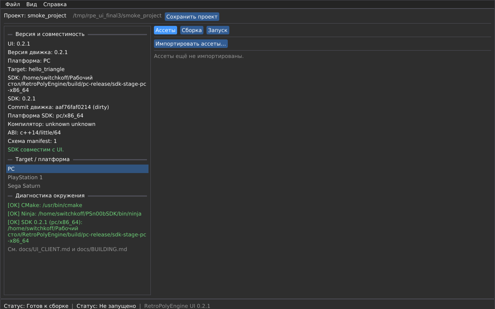

# UI client RetroPolyEngine

> Спринт 35–36 (недели 69–72), веха v0.2.1. Архитектурное решение —
> [`adr/ADR-012-ui-client.md`](adr/ADR-012-ui-client.md). Релизная политика —
> [`RELEASING.md`](RELEASING.md).

UI client — launcher/editor движка: создание и открытие проекта, выбор
target'а (PC/PS1/Saturn), импорт ассетов через SDK `asset_converter`,
сборка через установленный SDK и запуск target'а/эмулятора.

UI **не содержит** движок и demo-код: он работает с установленным SDK по
`sdk_manifest.json` и вызывает CMake/Ninja/`asset_converter` отдельными
процессами.



## 1. Установка и запуск

UI поставляется отдельным архивом (SDK — отдельно):

```
ui/
  retro-engine-ui[.exe]
  assets/DejaVuSans.ttf
  assets/DejaVu-LICENSE.txt
  samples/cube.gltf
  samples/texture.png
  README-ui.md
  VERSION.txt
  LEGAL.md
  ui_manifest.json
  checksums.sha256
```

```sh
# Linux
tar -xzf retro-engine-ui-0.2.1-linux-x86_64.tar.gz
./ui/retro-engine-ui

# Windows
# распаковать zip, запустить ui\retro-engine-ui.exe

# macOS
# распаковать zip (или .dmg), запустить ui/retro-engine-ui
```

Проверка целостности:

```sh
cd ui
sha256sum -c checksums.sha256
```

При первом запуске откройте **Вид → Настройки** и укажите SDK PC
(каталог, содержащий `sdk_manifest.json`). Автопоиск проверяет
`RPE_SDK_*`-переменные, `sdk_root` и `sdk_root/pc|ps1|saturn`.

## 2. Поддерживаемые версии

- UI `0.2.x` работает с SDK `0.2.x` (та же major/minor-серия).
- Отличие patch-версии — предупреждение; отличие major/minor — отказ
  (target disabled / ошибка открытия).
- `ui_manifest.json` фиксирует `sdk_series: "0.2"`, версию, OS/arch,
  компоненты и SHA-256 файлов.
- В панели **Версия и совместимость** видны версии UI/SDK, commit движка,
  ABI/compiler и schema manifest.

## 3. Быстрый старт

1. **Новый проект** → имя, каталог, target PC, шаблон `hello_triangle`.
2. **Импортировать ассеты** → `samples/cube.gltf`, `samples/texture.png`
   (или свои `.gltf`/`.glb`/`.png`/`.jpg`).
3. Вкладка **Сборка** → **Собрать**; лог CMake/Ninja транслируется в UI.
4. Вкладка **Запуск** → **Запустить**; для PC запускается executable, для
   PS1/Saturn — `.cue` в настроенном эмуляторе.

Для чистого E2E:

```sh
python3 scripts/ui_e2e.py \
  --sdk-archive dist/retro-engine-sdk-0.2.1-pc-linux-x86_64.tar.gz \
  --ui-package dist/retro-engine-ui-0.2.1-linux-x86_64.tar.gz
```

## 4. Модель проекта `.rpeproject`

Файл `.rpeproject` лежит в корне проекта (JSON, схема 1):

```json
{
  "schema": 1,
  "name": "my_project",
  "engine_version": "0.2.1",
  "sdk_path": "/opt/retro-engine-sdk",
  "target": "hello_triangle",
  "platform": "pc",
  "assets": [
    {
      "source": "assets/source/cube.gltf",
      "output": "assets/build/cube.mesh",
      "type": "mesh",
      "size": 600,
      "source_size": 2732,
      "width": 0,
      "height": 0,
      "vertex_count": 24,
      "triangle_count": 12,
      "texture_id": 0
    }
  ],
  "build_dir": "build",
  "run_target": "hello_triangle",
  "emulator_path": ""
}
```

Правила:

- неизвестные поля — ошибка загрузки (детерминированно);
- `assets[].source/output`, `build_dir`, `run_target` — только безопасные
  относительные пути внутри проекта; `..`/абсолютные пути запрещены;
- `engine_version` — строгий semver `X.Y.Z`;
- `platform` — `pc`/`ps1`/`saturn`;
- отсутствующие source/output/SDK/эмулятор — предупреждения в
  **Диагностике**, проект всё равно открывается.

Структура нового проекта:

```
my_project/
  .rpeproject
  CMakeLists.txt
  README.md
  src/main.cpp
  src/scene.h            # шаблон hello_triangle (PC)
  assets/source/
  assets/build/
  build/                 # CMake-каталог: build/<platform>/
```

Каталог CMake — `build_dir/<platform>` (`build/pc`, `build/ps1`,
`build/saturn`), чтобы target'ы не конфликтовали в одном CMake cache.

## 5. Target'ы и SDK

| Target | Доступность | Запуск |
|---|---|---|
| PC | SDK `platform=pc` + `asset_converter` | executable из `build/pc[/bin]` |
| PS1 | SDK `platform=ps1` + `PSN00BSDK_LIBS` | `.cue` в DuckStation/совместимом эмуляторе |
| Saturn | SDK `platform=saturn` + `JO_ENGINE_ROOT` | `.cue` в Mednafen |

Если SDK/env/эмулятор отсутствует, target показывается disabled с
объяснением; сборка невозможна, но проект открывается.

Переключение target у существующего проекта меняет `platform`, `target`,
`sdk_path`, `engine_version` и каталог сборки, но **не портирует исходники**
проекта. Для PS1/Saturn создавайте проект сразу под нужную платформу —
шаблоны `hello_triangle_ps1`/`hello_triangle_saturn` берутся из SDK.

## 6. Ассеты

- Поддерживаются `.gltf`, `.glb`, `.png`, `.jpg`, `.jpeg`.
- Источник копируется в `assets/source/`, конвертер вызывается как
  `asset_converter <source> <output>`, результат — `assets/build/*.mesh`
  или `*.tex`.
- UI показывает тип, размер, для мешей — вершины/треугольники/`texture_id`,
  для текстур — размеры/слот.
- Повторный импорт обновляет запись; удаление удаляет запись и output-файл.
- `.mesh`/`.tex` заголовки проверяются после конвертации; повреждённый
  output не попадает в проект.

## 7. Сборка и запуск

Команды видны в логе (и в `ui_manifest`/документации):

```sh
cmake -S <project> -B <project>/build/pc -G Ninja \
  -DCMAKE_BUILD_TYPE=Release -DCMAKE_MAKE_PROGRAM=<ninja> \
  -DCMAKE_PREFIX_PATH=<sdk>
cmake --build <project>/build/pc --target <target> --config Release
```

Для PS1/Saturn добавляется `-DCMAKE_TOOLCHAIN_FILE=<sdk>/cmake/...` и
`-DJO_ENGINE_ROOT` (Saturn). Стадии configure/build идут отдельными
процессами; stdout+stderr streaming, кнопка **Отменить сборку**, exit code
показывается в статусе.

Запуск:

- PC — `<project>/build/pc/hello_triangle` (или `bin/`, `game/`).
- PS1/Saturn — первый `.cue` в `build/<platform>/`, `dist/` или корне проекта;
  путь и команда эмулятора видны в логе.

## 8. Настройки

Хранятся вне репозитория:

| ОС | Каталог |
|---|---|
| Linux | `$XDG_CONFIG_HOME/retro-engine-ui` или `~/.config/retro-engine-ui` |
| macOS | `~/Library/Application Support/RetroPolyEngine` |
| Windows | `%APPDATA%/RetroPolyEngine` |

`RPE_UI_CONFIG_DIR` переопределяет каталог (CI/smoke/E2E).

Поля: `sdk_root`, `sdk_pc`, `sdk_ps1`, `sdk_saturn`, `cmake_path`,
`ninja_path`, `emulator_ps1`, `emulator_saturn`, `theme`, `language`,
`recent_projects` (максимум 10).

## 9. Диагностика

Панель **Диагностика окружения** проверяет:

- CMake ≥ 3.25 и Ninja (PATH/настройки);
- SDK: manifest, компоненты, `asset_converter`, версия;
- `PSN00BSDK_LIBS` (PS1), `JO_ENGINE_ROOT` (Saturn);
- эмулятор для выбранного target'а;
- наличие source/output ассетов.

Сообщения содержат ссылку на `docs/UI_CLIENT.md` и `docs/BUILDING.md`.

## 10. Сборка UI из исходников

```sh
cmake --preset ui-debug
cmake --build --preset ui-debug --target retro_engine_ui
./build/ui-debug/ui/retro_engine_ui

# release-пакет
cmake --preset ui-release
cmake --build --preset ui-release --target retro_engine_ui
python3 scripts/package_ui.py --build-dir build/ui-release \
  --version 0.2.1 --output-dir dist
```

Пресеты: `ui-debug` (Debug + тесты), `ui-release` (Release, без тестов).
Требования: CMake ≥ 3.25, Ninja, OpenGL 3.3, SDL3/ImGui submodules
(`git submodule update --init --recursive`).

## 11. Тесты и CI

```sh
# core-тесты без дисплея (project/sdk/commands/process/assets)
./build/ui-debug/tools/ui_client/retro_engine_ui_tests

# headless smoke (Linux): new project → import → build → run
python3 scripts/ui_smoke.py \
  --sdk-dir build/pc-release/sdk-stage-pc-x86_64 \
  --ui-binary build/ui-release/ui/retro_engine_ui

# PS1/Saturn: сборка из UI (запуск .cue — ручной gate эмулятора)
python3 scripts/ui_smoke.py --platform ps1 --no-run \
  --sdk-dir build/ps1-release/sdk-stage-ps1-mips \
  --ui-binary build/ui-release/ui/retro_engine_ui

# чистый E2E: SDK archive + UI package
python3 scripts/ui_e2e.py --sdk-archive ... --ui-package ...
```

CI: `.github/workflows/ui-client.yml` — matrix Ubuntu/Windows/macOS
(`ui-debug` тесты, `ui-release` сборка, package artifact), Linux — SDK
`pc-release` + `sdk_package` + clean E2E под `xvfb-run`.

### 11.1. Ручной gate PS1/Saturn (пройден 2026-11-13)

`.cue` собран из UI-проекта и запущен в настроенном эмуляторе; UI
показывает команду, pid и лог процесса:

```sh
# 1) собрать проект из UI (build-only)
python3 scripts/ui_smoke.py --platform ps1 --no-run \
  --sdk-dir build/ps1-release/sdk-stage-ps1-mips \
  --ui-binary build/ui-release/ui/retro_engine_ui --work-dir /tmp/gate

# 2) сгенерировать HELLO.cue/HELLO.bin из build/ps1/hello_triangle_ps1.exe
#    (mkpsxiso; Saturn — genisoimage + IP.BIN) и положить в <project>/dist

# 3) запустить через UI
xvfb-run -a build/ui-release/ui/retro_engine_ui \
  --project /tmp/gate/smoke_project --run-project --run-seconds 20 \
  --emulator /path/to/duckstation-or-mednafen-wrapper
```

Результаты: DuckStation — `RETRO SDK PS1`, Mednafen 1.32.1 — Saturn
`hello_triangle`/HAL init; скриншоты
[`ui_gate_ps1.png`](../screenshots/ui_gate_ps1.png),
[`ui_gate_saturn.png`](../screenshots/ui_gate_saturn.png).

## 12. Упаковка и release gate

`scripts/package_ui.py` создаёт:

- `retro-engine-ui-<ver>-<os>-<arch>.tar.gz` и `.zip`;
- macOS `.dmg` при наличии `hdiutil`;
- sidecar `.sha256` для каждого архива;
- `ui_manifest.json` + `checksums.sha256` внутри.

Запрещены BIOS/ROM/секреты/build-каталоги; проверка встроена в packager,
`scripts/ui_e2e.py` и `scripts/verify_release_contract.py`
(`ui_archives`, `ui_manifest`).

## 13. Ограничения v0.2.1

- Нет полноценной IDE: только project/target/assets/build/run/diagnostics.
- Нет визуального редактора сцены/материалов.
- Нет автоматического создания ISO для PS1/Saturn из UI: запускается
  готовый `.cue` (сборка ISO — задача проекта/скриптов).
- Переключение target не портирует исходники проекта.
- AppImage не собирается без внешнего `linuxdeploy`/`appimagetool`;
  Linux-пакет — `.tar.gz`/`.zip`.

## 14. Troubleshooting

| Симптом | Решение |
|---|---|
| `CMake not found` / `Ninja not found` | Установите CMake ≥ 3.25/Ninja; укажите путь в Настройках |
| SDK disabled | Проверьте `sdk_manifest.json`, версию 0.2.x, `platform` и компоненты |
| PS1 target disabled | `export PSN00BSDK_LIBS=$HOME/PSn00bSDK/lib/libpsn00b` |
| Saturn target disabled | `export JO_ENGINE_ROOT=$HOME/joengine` (v2026.2) |
| Import failed | Проверьте `tools/asset_converter`, расширение и лог конвертера |
| Run: `.cue` not found | Соберите ISO/`.cue` проекта или укажите `dist/` |
| UI не стартует на Linux | Нужен OpenGL 3.3 и X11/Wayland; headless — `xvfb-run` |
